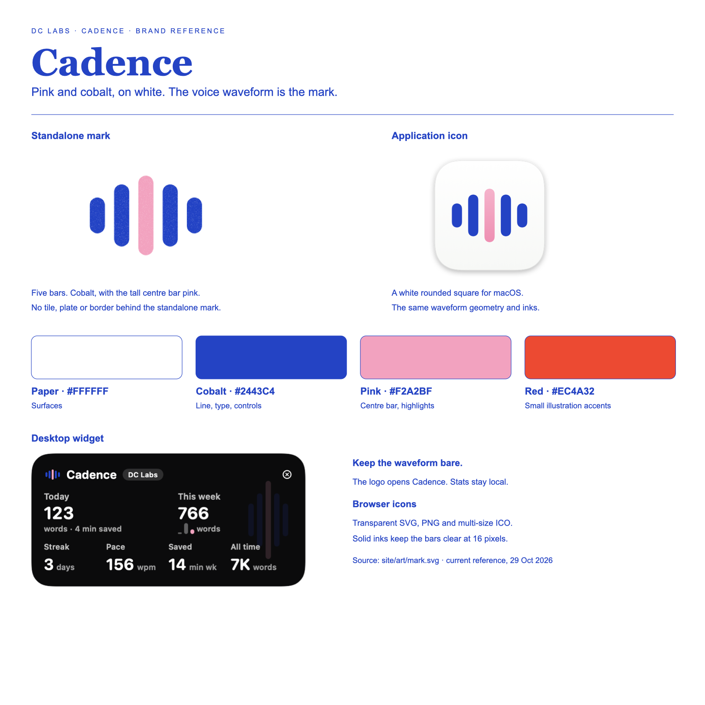

# Cadence brand, v1 (riso)

Cadence looks like a risograph print: two inks on white paper, drawn with one confident
line. It's warm, a little handmade and a little off-register. That suits a tool about your
own voice, and it sets Cadence apart from the glossy gradients every other dictation app uses.
Adopted 29 Oct 2026, when Daniel picked the riso direction for Cadence marketing.

The source files live in [`site/art/`](../../site/art/), the one place the site and this
guide both read from. Don't copy them anywhere else.

Editable reference: [brand-guide.svg](brand-guide.svg).

## Paper and inks

One paper and three inks. The art is printed only in the three inks, and the paper is whatever it sits on.

| Colour | Hex | Use |
| --- | --- | --- |
| Paper | `#FFFFFF` | Background, and the card behind every illustration. White, never cream (Daniel, 29 Oct). Alternate bands use a faint pink wash, `#FDF3F7` |
| Cobalt | `#2443C4` | Line work, headings, buttons. The main ink |
| Pink | `#F2A2BF` | Fills, and the offset "plate" shadow behind cards and buttons |
| Red | `#EC4A32` | The spot colour: one accent per view (mouth, caret, the hand-drawn loop). Not the mark: its peak bar is pink |

Small red **text** (labels, kickers) uses the deeper `#B02D18`, because bright red on white
is only 3.2:1. The deeper red passes WCAG AA (4.5:1) on every surface.

Night mode keeps the same inks on a deep ink-blue sheet (`#141A3D`). Cobalt and red *text* lift to
`#8FA2FF` and `#FF7A63` so they stay readable (site tokens only, never inside the art), and the illustrations stay on white cards, like prints
pinned to a dark wall.

## Paper texture

The white is paper, not screen. `site/paper.svg` tiles a fine tooth and faint fibres over the page,
the cards and the bands (one CSS rule lists every surface, and a test checks nothing is left flat).
Illustration cards may run a breath warmer (`#FDFAF3`) so the figures sit on a sheet, while the page
stays white. In night mode only the prints keep the texture, because grey speckle on ink-blue reads as static.

## Motion

- **Hand-drawn loop:** a red pencil loop draws itself around a key title once (2.5 s), with the
  same grain as the art. Use it once per page at most.
- **Voice orb:** pink turning to cobalt, with a red spark, printed with the speckle. It moves only
  with your voice, and the microphone is opt-in, loudness only, never recorded.

## Rules for the art

- **Two plates.** The pink plate prints first and sits slightly off register (about 5px
  down-right). Cobalt line work prints over it, and red is used sparingly.
- **Line.** One weight per drawing (6–7 at the drawing's scale), with round caps and joins.
  There are no gradients and no outlines on the pink.
- **Grain.** Every ink carries the same speckle filter (`#grain`, fractal noise, seed 7),
  so the colour looks pressed into the paper rather than flat. Apply it once, on one group
  that wraps the whole drawing.
- **Only the three inks.** No paper fill inside the art. The site tests reject any other colour in `site/art/`.
- **Self-contained.** No scripts, no inline CSS, no remote fonts or images. The site's
  strict Content-Security-Policy covers the SVGs too.
- **Original.** Draw the art fresh. Riso is the technique, not a borrowed character.

## The set

| File | What it shows | Where |
| --- | --- | --- |
| `announcer.svg` | A radio announcer at a vintage mic; the words leave as a ribbon of type | Hero |
| `hold.svg` | A finger pressing the Option key | Step 1 |
| `speak.svg` | A microphone with sound coming in from both sides | Step 2 |
| `release.svg` | A page of fresh type with a red caret | Step 3 |
| `jar.svg` | A laptop under a bell jar: nothing leaves your Mac | Privacy feature |
| `bubbles.svg` | "hi" and "hola" | Two-languages feature |
| `mark.svg` | The app icon's five bars (same 824 grid): cobalt, with the tallest in pink. No tile or background ink; it sits on white paper | Header, footer, favicon |

## Type

- **Display:** Iowan Old Style, then New York, then Georgia, in bold. Italic is for the red
  second line of a headline.
- **Labels:** the system sans in small capitals with wide tracking (0.24em), in red.
- **Body:** the system sans.

All three are system fonts, so nothing is downloaded.

## Voice

Plain and confident. Say what it does: "Speak. It types." Don't use emojis, and don't
use exclamation marks.

## The app

Since 29 Oct 2026 the app wears the same inks. The icon (`platform-macos/App/AppIcon/render-icon.swift`)
keeps its original geometry and white plate, with cobalt bars and a pink peak, drawn in sRGB so the
hex values land exactly. `BrandColor.swift` has `accent` (pink: bars and fills), `accentStrong`
(cobalt: emphasis text and buttons, because pink is too light to carry text), `accentSoft` and
`accentWash`, plus `button` (cobalt fills with white labels). In light mode the pinks are deepened
(`#D9578B` marks, `#EE8FB2` past-day bars) so they stay visible on white. The HUD's live waveform is pink.

## Icon delivery and cache refresh

`site/art/mark.svg` remains the geometry source. Run `swift qa/render-web-icons.swift`
from the repository root to derive the clean small-size browser icons. Both HTML
pages use the versioned `favicon-riso-v2.svg` / `.png` and
`apple-touch-icon-riso-v2.png`, so old green browser caches cannot keep selecting
the old URLs. `/favicon.ico` and `/favicon.png` remain branded fallbacks. Share
metadata uses `icon-512-riso-v2.png`. When changing icon artwork again, change the
URL version on both pages and in `site/files.mjs`.

The standalone and widget marks have no plate. The macOS application icon keeps
its white rounded plate. Tiny browser icons use solid inks without grain so the
five bars remain distinct. The reference image above is generated from the SVG
reference; it is not a screenshot of an earlier site or an old logo proposal.
